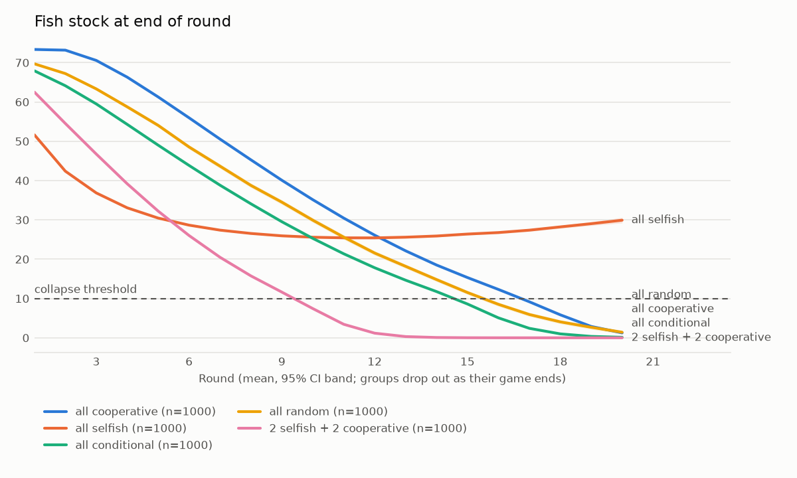
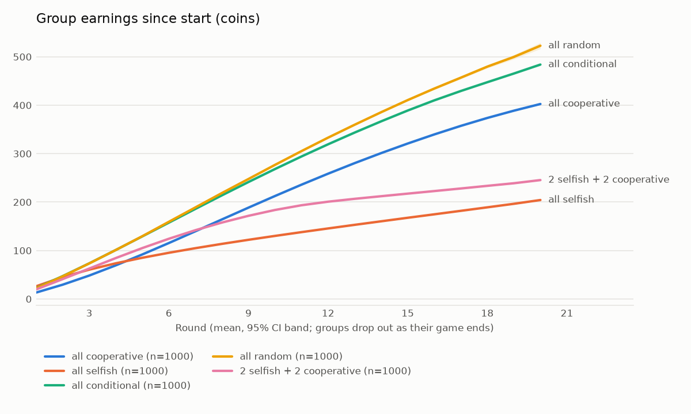
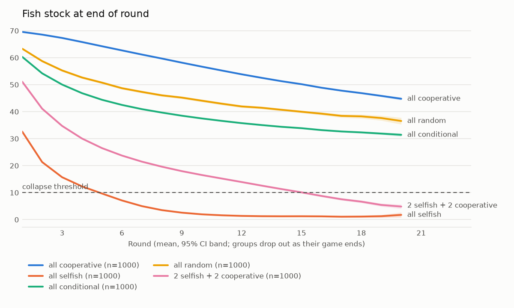
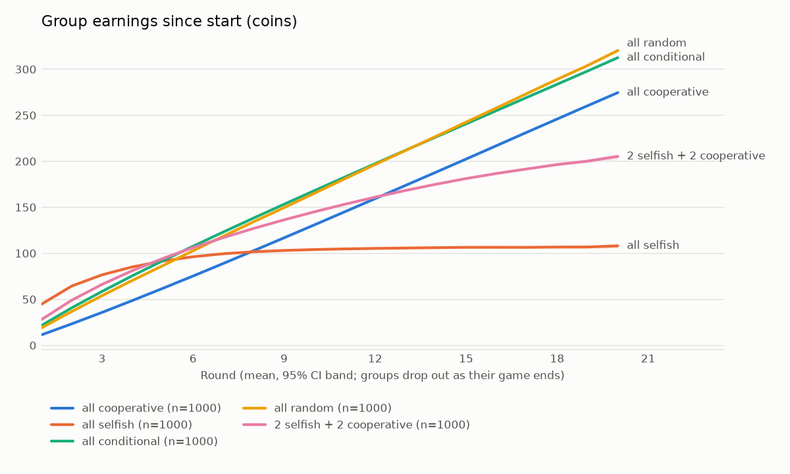

# Simulation and dilemma check (Milestone 2)

All numbers are from 1,000 seeds per strategy mix, condition `none` (default policy, all levers off).
Reproduce with:

```bash
cd backend
poetry run python -m app.sim dilemma --seeds 1..1000 --params config/default.yaml        # calibrated (current)
poetry run python -m app.sim dilemma --seeds 1..1000 --params config/spec_original.yaml  # original spec values
poetry run python -m app.sim simulate --params config/default.yaml --seeds 1..1000 --plot --out sim_output/default \
  --strategy-mix cooperative --strategy-mix selfish --strategy-mix conditional --strategy-mix random \
  --strategy-mix selfish:2,cooperative:2
```

Full reports: [`default/dilemma.txt`](default/dilemma.txt) (calibrated, current), [`spec_original/dilemma.txt`](spec_original/dilemma.txt)
(JSON next to them). Bots: cooperative = 2/6/2 (harvest/contribute/save), selfish = 10/0/0,
conditional = last round's group average, random = uniform over all splits.

## Original spec values: all three checks fail (`config/spec_original.yaml`)

| Check | Target | Original spec values |
| --- | --- | --- |
| (a) coop vs selfish group earnings | ≥ 2× | **1.96×** (363 vs 185 coins) |
| (b) selfish out-earns coop in a round (stock alive) | 100% | **82.8%** of rounds |
| (c) all-selfish stock collapse | within ~6–8 rounds | **never** (0 of 1,000; stock levels off near 28) |

Why they fail:

1. **Infrastructure makes cooperators over-fish.** A multiplies every harvest
   (h = q·e_h·S·θ·A). Four cooperators contribute 24 points a round, so A climbs toward
   γ·24/d = 24. Even a 2-point harvest then removes more than regrowth replaces:
   60% of all-cooperative groups collapse the stock, versus none of the all-selfish groups.
2. **Saving beats fishing.** One harvest point earns q·S·θ·A ≈ 0.7 coins at the starting
   stock (at most 1.0 even at full stock K=100 with average skill), while one saving point
   earns ρ = 1 coin with no risk. Pure saving beats max harvest in 70% of rounds, so
   "selfish" bots are not actually self-interested.
3. **Selfish groups can't empty the sea.** With q = 0.01, four full-time harvesters take
   40% of the stock per round, which equals r = 0.4, and A decays when nobody contributes.
   The stock settles at an interior level instead of collapsing.




## Calibrated defaults (adopted): `backend/config/default.yaml`

Found by grid search over q, ρ, γ, d (`γ_pot` kept equal to γ) and adopted as the defaults
after review. All other parameters keep their spec values.

| Parameter | Spec | Calibrated | Effect |
| --- | --- | --- | --- |
| catchability q | 0.01 | **0.017** | four selfish players out-harvest regrowth → collapse |
| saving return ρ | 1.0 | **0.3** | harvesting pays more than saving while the stock is healthy |
| infrastructure gain γ | 0.02 | **0.005** | caps A for cooperators (steady state ≈ 2.4 instead of 24) |
| infrastructure depreciation d | 0.02 | **0.05** | (same) |
| pot→infrastructure γ_pot | 0.02 | **0.005** | kept equal to γ |

| Check | Calibrated |
| --- | --- |
| (a) | **PASS** — 2.22× (238 vs 107 coins) |
| (b) | **99.9%** of live rounds (5,884 contexts). The few exceptions are all-selfish groups hovering just above the collapse threshold (S < 12) with decayed infrastructure, where the two strategies differ by < 0.1 coin. |
| (c) | **PASS (borderline early)** — 92% of all-selfish groups collapse; median collapse round 5; 39% collapse in rounds 6–8 and 89% by round 8 |

Cooperative groups no longer collapse (0 of 1,000; mean final stock 47.5).




## Open points

- **Collapse timing.** The collapse round is spread widely (rounds 3–11) because skills and
  events vary. q = 0.0165 moves the median to 6 but only 83% of groups collapse and (a) drops
  to 2.10×. Raising q pulls collapse earlier; lowering it lets more selfish groups survive.
- **Endowments swamp earnings.** Initial wealth (≈ 500 coins per group) is larger than
  20 rounds of earnings, so *total final welfare* differs only 1.2× between all-cooperative
  and all-selfish groups. Check (a) therefore compares *earnings* (final − initial). If
  welfare should include endowments, the endowment range would need to shrink a lot
  (e.g. [10, 40]).
- **The cooperative bot under-harvests.** With the calibrated values, conditional and random
  groups earn more than all-cooperative groups (276–280 vs 238), because 2/6/2 leaves fish
  in the sea. That is fine for the dilemma check but shows that the welfare-maximizing
  strategy is moderate harvesting, not minimal.
